 

<b>Açıyı ve gücü seç, köfteyi fırlat.</b> Düğmeye basınca GitHub'ın "issue" sayfası açılır, her şey hazır doldurulmuştur: yeşil <b>Create</b> düğmesine basman yeter. Mancınık 10–20 saniye içinde atışı hesaplar, sonucu o sayfaya yazar ve buradaki sahne güncellenir. 
Kazan 5 · tabak 3 · sepet 1 puan. Kazanı vuran seviyeyi geçirir. Rüzgâr her atışta değişir, sahnedeki bayrağa bak.

<table align="center">
  <tr><th></th><th>güç 1 → 5</th></tr>
  <tr><td align="right"><b>Alçak</b> 30°</td><td></td></tr>
  <tr><td align="right"><b>Orta</b> 45°</td><td></td></tr>
  <tr><td align="right"><b>Yüksek</b> 70°</td><td></td></tr>
</table>

<b>Nasıl çalışıyor?</b>

 

Bu sayfada çalışan bir kod yok; her şey GitHub'ın kendi araçlarıyla dönüyor.

- **Köfte yolu:** Her gece GitHub Actions katkı takvimini okuyor ve Mini Totem'in yürüdüğü yolu yeniden çiziyor. Yalnızca günlük toplam sayılar kullanılıyor.
- **Durum kartı:** Aynı iş son YouTube videosunu ve katkı serisini kartın içine yazıyor.
- **Köfte Mancınığı:** Bastığın düğme bir issue açıyor. Bir Action atışı gerçek bir atış eğrisiyle hesaplıyor (açı, güç, rüzgâr, kaya), cevabını yazıp issue'yu kapatıyor, skoru ve sahneyi güncelliyor.

  <a href="https://ferhat.work"><b>ferhat.work</b></a> &nbsp;·&nbsp;
  <a href="https://www.youtube.com/@ferhatwork">YouTube</a> &nbsp;·&nbsp;
  <a href="https://x.com/ferhatwork">X</a> &nbsp;·&nbsp;
  <a href="https://www.tiktok.com/@ferhatwork">TikTok</a> &nbsp;·&nbsp;
  <a href="https://www.instagram.com/ferhatwork/">Instagram</a> &nbsp;·&nbsp;
  <code>hello@ferhat.work</code>

